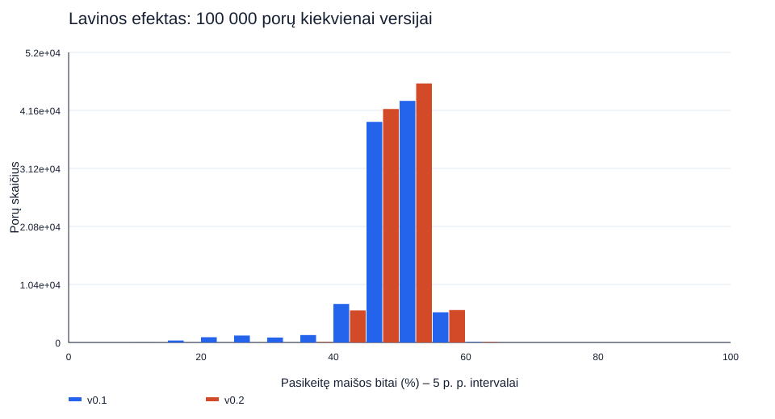
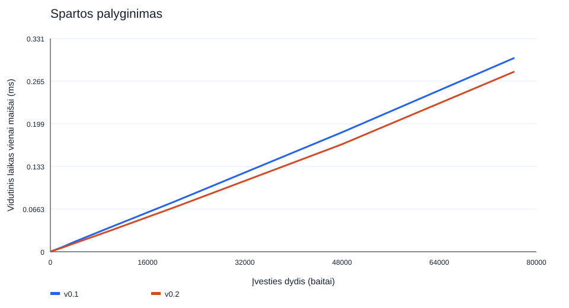

# Mokomasis 256 bitų maišos generatorius

Autorius: Jakub Rogoža. Blokų grandinių technologijų 1 praktinė užduotis.

## Greitas paleidimas

Reikia .NET 9 runtime ir suderinamo SDK. Šis seansas: SDK 10.0.401, runtime .NET 9.0.20, Windows build 26200, x64, 24 loginiai procesoriai. Visų eksperimentų konfigūracija Release; detalės yra `comparison/*/results/*-metadata.txt`.

Iš repozitorijos šaknies:

```powershell
dotnet build Blockchain -c Release
dotnet run --project Blockchain -c Release
dotnet run --project Blockchain -c Release -- --version v0.1
dotnet run --project Blockchain -c Release -- --version v0.2 "Blockchain/test-data/konstitucija.txt"
./Compare-Versions.ps1
```

Numatytoji versija v0.2. Eksperimentus atskirai paleisk iš `Blockchain` aplanko: `dotnet run -c Release -- --version v0.2 --test`, taip pat `--avalanche`, `--collisions`, `--performance`, `--guessing`. `--test` paleisk du kartus. Tame pačiame `results` aplanke nekeisk versijos, nes baseline priklauso nuo algoritmo; bendras scenarijus abiem versijoms sukuria atskirus aplankus ir neperrašo ankstesnio seanso.

Trumpas pasirengimas gynimui: [GYNIMAS.md](GYNIMAS.md).

## Įvestis, išvestis ir pradinė idėja

Tekstas koduojamas UTF-8; failas skaitomas kaip tikslūs baitai, įskaitant BOM ir eilučių pabaigas. Tarpai nešalinami, registras nekeičiamas, Unicode nenormalizuojamas. Rankinis režimas priima vieną eilutę ir neįtraukia Enter pabaigos. `Ąžuolas 🌳` užima 14 UTF-8 baitų. `File.ReadAllBytes` įkelia visą failą: praktinė riba priklauso nuo atminties ir .NET masyvo ribų, srautinio apdorojimo nėra. Neperskaitomas failas praneša klaidą ir grąžina 1.

Būsena: 8 × 32 bitų `uint` = 256 bitų = 32 baitai = 64 HEX simboliai. `X8` išsaugo pradinius nulius. Kiekvienam kvietimui sukuriama nauja pradinė būsena.

v0.1 pseudokodas:

```text
H ← [10,20,30,40,50,60,70,80]; start ← 0
kiekvienam baitui b:
    H[start] ← ROTL32((H[start] + b) × 7, 5)
    previous ← start
    kartoti 7 kartus:
        current ← (previous + 1) mod 8
        H[current] ← ROTL32(H[current] + 3 × H[previous], 11)
        previous ← current
    start ← (start + 1) mod 8
grąžinti H
```

Sudėtis ir daugyba vyksta modulo 2^32 (`unchecked`). Atnaujinimai vyksta vietoje: vėlesnis elementas naudoja jau atnaujintą ankstesnį. Konstantos ir rotacijos yra projektavimo pasirinkimai, ne saugumo garantija.

v0.2 pseudokodas:

```text
H ← v0.1(įvestis)
H[0] ← H[0] XOR apatiniai32(baitų_ilgis)
H[1] ← H[1] XOR viršutiniai32(baitų_ilgis)
round nuo 0 iki 3:
    i nuo 0 iki 7:
        next ← H[(i+1) mod 8]; opposite ← H[(i+4) mod 8]
        x ← H[i] + ROTL32(next,7) + 0x9E3779B9 + round
        x ← x XOR ROTL32(opposite,13)
        x ← (x XOR (x >> 16)) × 0x85EBCA6B
        x ← (x XOR (x >> 13)) × 0xC2B2AE35
        H[i] ← x XOR (x >> 16)
grąžinti kiekvieną H žodį formatu X8
```

Visi atnaujinimai yra 32 bitų, vyksta vietoje. Tuščiai įvesčiai v0.1 lieka pradinė būsena, v0.2 vis tiek atlieka galutinį maišymą.

## Versijų palyginimas

2026-11-05. Tai mokomasis algoritmas, o šie bandymai nėra kriptografinio saugumo įrodymas.

## Kas pakeista

v0.1 įvesties apdorojimas išsaugotas kaip `ComputeV01`. v0.2 pirmiausia apskaičiuoja v0.1 būseną, XOR operacija įtraukia įvesties baitų ilgį į pirmus du 32 bitų žodžius ir atlieka keturis papildomus visos būsenos maišymo ciklus. Kiekvienas ciklas atnaujina visus aštuonis žodžius vietoje, naudodamas gretimą ir priešingą žodį, bitų rotacijas, XOR, poslinkius ir daugybą modulo 2^32.

Tikslas: po paskutinio įvesties baito dar lieka 32 būsenos žodžių atnaujinimai, todėl jo įtaka gali pasklisti toliau. Ilgio įtraukimas daro ilgį aiškia galutinio maišymo dalimi. Tuščiai įvesčiai taip pat vyksta galutinis maišymas. Keturi ciklai yra eksperimentinis pasirinkimas; neįrodyta, kad tai optimalus ar saugus skaičius.

Naudoti XOR/poslinkių/daugybos maišymo principai ir žinomos konstantos `0x9E3779B9`, `0x85EBCA6B`, `0xC2B2AE35`; jos nėra naujai išrastos ar slapti raktai. Visa būsenos kombinavimo konstrukcija pateikta kode; standartinė maišos funkcija neiškviečiama.

## Lavinos efektas

| Įvesties ilgis | v0.1 bitų vid. % | v0.2 bitų vid. % | v0.1 min. % | v0.2 min. % |
|---|---:|---:|---:|---:|
| 10 | 46.0729 | 49.9808 | 12.8906 | 37.1094 |
| 100 | 49.6200 | 50.0111 | 15.2344 | 37.8906 |
| 500 | 49.9264 | 49.9831 | 16.4062 | 37.8906 |
| 1000 | 49.9774 | 50.0028 | 17.1875 | 36.3281 |
| all | 48.8992 | 49.9945 | 12.8906 | 36.3281 |




Bendras vidurkis pagerėjo nuo 48,8992 % iki 49,9945 %. Viso rinkinio minimumas nuo 12,8906 % pakilo iki 36,3281 %. Tai rezultatai šioms konkrečioms poroms. v0.2 rezultatas nėra reikalavimas, kad kiekviena pora pakeistų bent 50 % bitų. HEX rodikliai ir visos min./maks./vid. reikšmės pateiktos `comparison/*/results/avalanche-summary.csv`.

## Sparta



Visas failas turi 76 384 baitus. v0.1 vidurkis 0.301231 ms, v0.2 0.279937 ms. Tai vienas nuoseklus bandymų seansas; iš šio skirtumo negalima daryti išvados, kad papildomas maišymas pagreitino algoritmą. Matavimų sklaida, JIT optimizavimas ir sistemos apkrova ypač veikia mažas įvestis. v0.2 prideda fiksuotą operacijų skaičių, todėl asimptotinis laikas lieka O(n), būsena O(1), visas įvesties įkėlimas O(n) atminties. Žali matavimai ir minimumas / vidurkis / maksimumas saugomi atskirai kiekvienai versijai.

## Kiti bandymai ir sąlygos

- Abiem versijoms 24 teisingumo atvejai praėjo, taip pat sutapo dviejų atskirų paleidimų rezultatai.
- v0.1 visų 24 maišų reikšmės sutapo su prieš pakeitimą išbandyto kodo rezultatais.
- Tikra CLI integracija patikrinta su tuščia įvestimi, ASCII, lietuvišku tekstu su emoji, tarpais ir simbolių tvarka: rankinės įvesties ir failo maišos sutampa. Neegzistuojantis failas grąžina 1. Įrašas: `comparison/integration-checks.json`.
- Abiem versijoms tikrinta po 100 000 skirtingų porų kiekvienam ilgiui 10, 100, 500, 1000; taip pat visas kiekvieno ilgio rinkinys ir 23 struktūruotos įvestys. Kolizijų nerasta.
- Lavinos efektui po 25 000 porų kiekvienam ilgiui; seed 2026, ta pati ASCII abėcėlė ir generavimo kodas, .NET 9 vykdymo aplinka, SDK 10.0.401, Release.
- Abiem kandidatų paieškoms naudojami `0000`–`9999`, ta pati 16 baitų vieša druska ir tikslinis PIN `2026`. Abi versijos randa `2026`, išbandžius 10 000 kandidatų. Druska išsaugota, ji nėra slapta.
- Konstitucijos šaltinis: anksčiau projekto `test-data/konstitucija.txt` išsaugotas kurso failas, identiški 76 384 baitai abiem versijoms. Tiksli pradinė atsisiuntimo nuoroda šiame darbe neišlikusi; ji neišgalvota.

## Ribotumai

v0.2 yra deterministinė v0.1 būsenos ir ilgio transformacija. Jei dvi vienodo ilgio įvestys susiduria v0.1, jos susidurs ir v0.2: galutinis maišymas negali atkurti jau prarastos informacijos. Geresnė histograma savaime neįrodo geresnio atsparumo kolizijoms ar pirmavaizdžiams. Todėl konstrukcija mokomoji.

## DI pagalba ir versijų istorija

Šis v0.2 galutinis maišymas, versijos parinkimas, palyginimo automatizavimas ir dokumentacija parengti su Codex / GPT-6 pagalba. Pradinė v0.1 realizacija paimta iš esamo projekto; jos ankstesnės kūrimo istorijos nelaikome patikrintu darbo be DI įrodymu. Ankstesni testai bei README taip pat buvo rengiami su ChatGPT pagalba, kaip jau nurodyta ankstesniame README.

2026-11-05 užklausa: sukurti naują šaką ir patobulinti algoritmą, palyginti bei pasirengti gynimui. Priimta: išlaikyti seną algoritmą, įtraukti ilgį, pridėti galutinį maišymą. Nepasirinkta visiškai perrašyti algoritmą, nes mažesnį pakeitimą lengviau pagrįsti ir palyginti. Nepriimtas teiginys, kad geras lavinos efektas įrodo saugumą. Patikra: kompiliavimas, abu teisingumo paleidimai, CLI integracija ir visi statistiniai eksperimentai.

## Atkūrimas

Iš repozitorijos šaknies paleisk `./Compare-Versions.ps1`. Kiekviena versija turi atskirą rezultatų ir baseline aplanką. Scenarijus sąmoningai naudoja tą pačią viešą druską ir tą patį konstitucijos failą. Eksperimentų generavimo kodas yra `Blockchain/Experiments`; išsaugoti seed ir abėcėlė. v0.2 yra numatytasis režimas; ankstesnei versijai: `dotnet run -c Release --project Blockchain -- --version v0.1 --test`.

## Visos rezultatų suvestinės

Laikai milisekundėmis, lavinos rodikliai procentais. `all` žymi visus keturis ilgius kartu. `pair_collisions` – porinės kolizijos; `all_collisions` ir `collision_groups` – viso ilgio rinkinio sutapimai tarp skirtingų įvesčių. `matches` – kandidatų paieškoje rastos įvestys.

### v0.1

**performance-summary.csv**

| lines | bytes | repetitions | samples | min_ms | avg_ms | max_ms | megabytes_per_second |
|---|---|---|---|---|---|---|---|
| 1 | 71 | 65536 | 5 | 0.000285 | 0.001103 | 0.001475 | 64.388185 |
| 2 | 125 | 131072 | 5 | 0.000447 | 0.000475 | 0.000490 | 263.229516 |
| 4 | 209 | 65536 | 5 | 0.000676 | 0.000762 | 0.000812 | 274.101323 |
| 8 | 370 | 65536 | 5 | 0.001380 | 0.001403 | 0.001434 | 263.641025 |
| 16 | 1012 | 16384 | 5 | 0.003472 | 0.003772 | 0.003902 | 268.323371 |
| 32 | 1873 | 8192 | 5 | 0.006561 | 0.006867 | 0.007215 | 272.740970 |
| 64 | 3776 | 4096 | 5 | 0.013965 | 0.014714 | 0.015344 | 256.625423 |
| 128 | 9283 | 2048 | 5 | 0.035488 | 0.035776 | 0.036390 | 259.474238 |
| 256 | 20665 | 1024 | 5 | 0.078005 | 0.078820 | 0.079884 | 262.180819 |
| 512 | 47946 | 512 | 5 | 0.176960 | 0.185368 | 0.194642 | 258.653537 |
| 789 | 76384 | 256 | 5 | 0.288614 | 0.301231 | 0.327562 | 253.572695 |

**avalanche-summary.csv**

| length | pairs | bit_min_percent | bit_max_percent | bit_avg_percent | hex_min_percent | hex_max_percent | hex_avg_percent |
|---|---|---|---|---|---|---|---|
| 10 | 25000 | 12.8906 | 62.1094 | 46.0729 | 32.8125 | 100.0000 | 86.9915 |
| 100 | 25000 | 15.2344 | 64.0625 | 49.6200 | 35.9375 | 100.0000 | 93.0658 |
| 500 | 25000 | 16.4062 | 62.5000 | 49.9264 | 35.9375 | 100.0000 | 93.6305 |
| 1000 | 25000 | 17.1875 | 63.6719 | 49.9774 | 39.0625 | 100.0000 | 93.7135 |
| all | 100000 | 12.8906 | 64.0625 | 48.8992 | 32.8125 | 100.0000 | 91.8503 |

**collision-summary.csv**

| length | pairs | total_inputs | unique_inputs | pair_collisions | all_collisions | collision_groups |
|---|---|---|---|---|---|---|
| 10 | 100000 | 200000 | 200000 | 0 | 0 | 0 |
| 100 | 100000 | 200000 | 200000 | 0 | 0 | 0 |
| 500 | 100000 | 200000 | 200000 | 0 | 0 | 0 |
| 1000 | 100000 | 200000 | 200000 | 0 | 0 | 0 |

**guessing-summary.csv**

| mode | attempts | elapsed_ms | matches | matching_candidates |
|---|---|---|---|---|
| without_salt | 10000 | 13.054700 | 1 | 2026 |
| public_salt | 10000 | 9.780300 | 1 | 2026 |

### v0.2

**performance-summary.csv**

| lines | bytes | repetitions | samples | min_ms | avg_ms | max_ms | megabytes_per_second |
|---|---|---|---|---|---|---|---|
| 1 | 71 | 32768 | 5 | 0.001502 | 0.001560 | 0.001731 | 45.512999 |
| 2 | 125 | 32768 | 5 | 0.000517 | 0.001009 | 0.002540 | 123.909365 |
| 4 | 209 | 65536 | 5 | 0.000777 | 0.000778 | 0.000782 | 268.493393 |
| 8 | 370 | 65536 | 5 | 0.001290 | 0.001298 | 0.001315 | 285.127697 |
| 16 | 1012 | 16384 | 5 | 0.003332 | 0.003376 | 0.003428 | 299.764139 |
| 32 | 1873 | 16384 | 5 | 0.006048 | 0.006060 | 0.006073 | 309.096641 |
| 64 | 3776 | 8192 | 5 | 0.012277 | 0.012553 | 0.013292 | 300.803758 |
| 128 | 9283 | 2048 | 5 | 0.030326 | 0.030886 | 0.031710 | 300.557970 |
| 256 | 20665 | 1024 | 5 | 0.067547 | 0.069890 | 0.075163 | 295.677932 |
| 512 | 47946 | 512 | 5 | 0.156554 | 0.166803 | 0.177688 | 287.440995 |
| 789 | 76384 | 256 | 5 | 0.246772 | 0.279937 | 0.328996 | 272.861668 |

**avalanche-summary.csv**

| length | pairs | bit_min_percent | bit_max_percent | bit_avg_percent | hex_min_percent | hex_max_percent | hex_avg_percent |
|---|---|---|---|---|---|---|---|
| 10 | 25000 | 37.1094 | 62.8906 | 49.9808 | 75.0000 | 100.0000 | 93.7619 |
| 100 | 25000 | 37.8906 | 62.5000 | 50.0111 | 79.6875 | 100.0000 | 93.7174 |
| 500 | 25000 | 37.8906 | 62.8906 | 49.9831 | 76.5625 | 100.0000 | 93.7592 |
| 1000 | 25000 | 36.3281 | 61.3281 | 50.0028 | 76.5625 | 100.0000 | 93.7569 |
| all | 100000 | 36.3281 | 62.8906 | 49.9945 | 75.0000 | 100.0000 | 93.7489 |

**collision-summary.csv**

| length | pairs | total_inputs | unique_inputs | pair_collisions | all_collisions | collision_groups |
|---|---|---|---|---|---|---|
| 10 | 100000 | 200000 | 200000 | 0 | 0 | 0 |
| 100 | 100000 | 200000 | 200000 | 0 | 0 | 0 |
| 500 | 100000 | 200000 | 200000 | 0 | 0 | 0 |
| 1000 | 100000 | 200000 | 200000 | 0 | 0 | 0 |

**guessing-summary.csv**

| mode | attempts | elapsed_ms | matches | matching_candidates |
|---|---|---|---|---|
| without_salt | 10000 | 14.420200 | 1 | 2026 |
| public_salt | 10000 | 11.594200 | 1 | 2026 |

## Pateikimo ribos

Šakoje išsaugoti abiejų versijų rezultatai, grafikai ir atkūrimo scenarijus. Vietinis Git žymėjimas pats savaime nepatvirtina GitHub viešumo ar istorinio darbo be DI. Prieš pateikimą patikrink GitHub matomumą ir faktinę v0.1 kūrimo istoriją. Nuotolinis publikavimas šiame etape neatliekamas.

## Šaltiniai

- VU 2026 m. užduotis „Sukurk savo maišos generatorių“ ir kontrolinis sąrašas, vartotojo pateikti PDF.
- Esamas projekto kodas ir kursui naudotas `konstitucija.txt` (failas išsaugotas repozitorijoje; pradinė nuoroda neišlikusi).
- Vietoje gauti bandymų rezultatai; DI pagalba aprašyta aukščiau.

### Maišymo operacijų šaltinio patikslinimas

32 bitų XOR–poslinkių–daugybos seka su konstantomis 0x85EBCA6B ir 0xC2B2AE35 paimta iš Austin Appleby MurmurHash3 fmix32 galutinio maišymo (public domain): https://github.com/aappleby/smhasher/blob/master/src/MurmurHash3.cpp . Tai žinomas maišymo blokas, jo originalumo nepriskiriu sau. Šiame darbe jis panaudotas savo aštuonių žodžių būsenos papildomame maišyme; visa MurmurHash3 funkcija nekopijuojama ir neiškviečiama.

Vietinė v0.1 žyma sukurta 2026-11-05 prie jau buvusio commit dcc12f2; ji neatkuria ankstesnio pateikimo datos ar darbo be DI įrodymo. v0.2 žyma žymi šį DI pagalba parengtą etapą.
